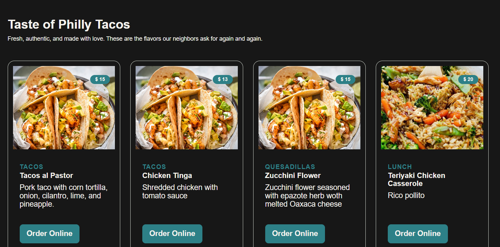
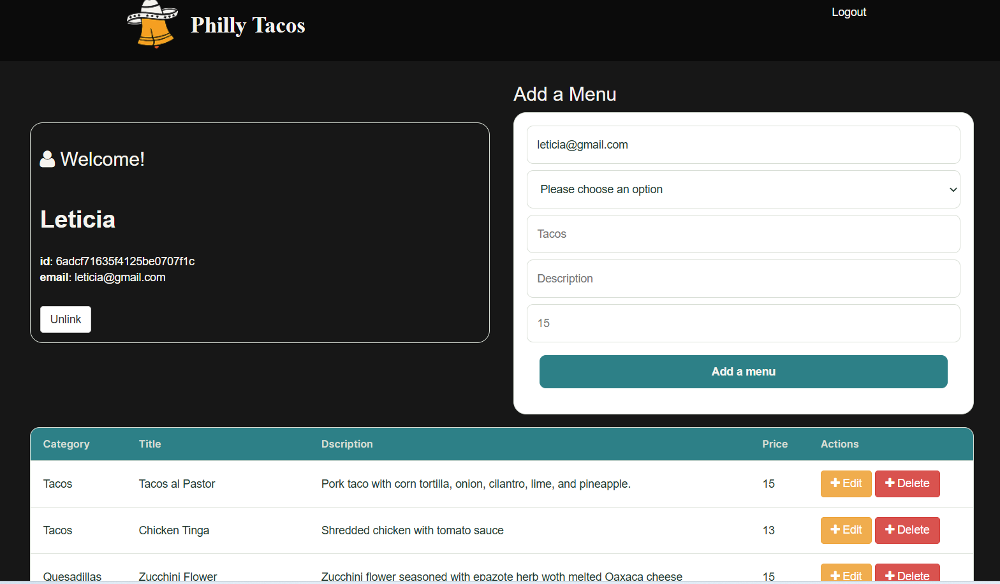

# Philly Tacos 🌮

Web app for a Mexican restaurant. Visitors can browse their menu, information of the restaurant,
and registered users can log in and manage the menu (create, edit, delete items) from a private profile page.

## Features
- Public home page with the menu displayed as cards (first 4 items, then a "View full menu" button)
- User signup and login with Passport (local strategy)
- Profile page with a table to **create, read, update and delete** menu items
- Edit items through a dialog form
- Item images fetched automatically from TheMealDB (for now) until I found another way to upload images when none is provided
- Responsive layout for mobile, tablet and desktop

## Tech stack
- **Backend:** Node.js, Express
- **Database:** MongoDB Atlas with Mongoose
- **Auth:** Passport.js (passport-local), express-session, connect-flash, bcrypt-nodejs
- **Views:** EJS
- **Frontend:** HTML, CSS, vanilla JavaScript, Bootstrap 3

## Getting started
 
### Prerequisites
 
- Node.js 18 or later
- A MongoDB Atlas cluster

## Installation

1. Clone repo
2. cd philly-tacos
3. run `npm install`

### Environment variables
 
Create a `.env` file in the project root:
USER_DB=your_atlas_username
PASS_DB=your_atlas_password
SERVER_DB=your-cluster.xxxxx.mongodb.net
SESSION_SECRET=a_long_random_string

## Usage

1. run `node server.js`
2. Navigate to `localhost:8080`

### Run
node server.js

## Deployment

https://philly-tacos.onrender.com/
